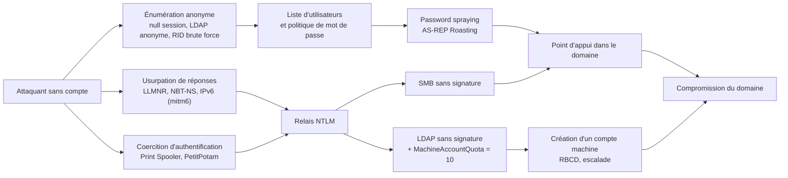

# Rapport technique : audit et durcissement d'Active Directory (wyrmwood.local)

**Destinataire :** Direction des Systèmes d'Information (DSI)
**Objet :** constats, risques et plan d'action pour réduire la surface d'attaque Active Directory
**Date :** 20 novembre 2026
**Auteur :** [Nom Prénom]
**Version :** 1.0

> Les preuves (captures d'écran) sont stockées dans le dossier [`screenshots/`](screenshots/) du dépôt. Chaque constat renvoie vers ses captures par un lien cliquable, au format `screenshots/screenshot-<numéro>.png`.

---

## Sommaire

1. [Synthèse pour la direction](#1-synthèse-pour-la-direction)
2. [Périmètre et objectif de l'analyse](#2-périmètre-et-objectif-de-lanalyse)
3. [Méthodologie](#3-méthodologie)
4. [Constat transversal : le danger des paramètres par défaut](#4-constat-transversal--le-danger-des-paramètres-par-défaut)
5. [Chaîne d'attaque observée](#5-chaîne-dattaque-observée)
6. [Tableau de synthèse des constats](#6-tableau-de-synthèse-des-constats)
7. [Constats détaillés](#7-constats-détaillés)
8. [Plan d'action proposé](#8-plan-daction-proposé)
9. [Risques de régression et précautions](#9-risques-de-régression-et-précautions)
10. [Limites et suites](#10-limites-et-suites)

---

## 1. Synthèse pour la direction

L'audit du domaine Active Directory `wyrmwood.local` a mis en évidence **15 constats**. Ils ont tous été corrigés et revérifiés sur les hôtes audités (DC01 et MS01).

**Message principal : la première source de faiblesse d'un Active Directory est son paramétrage par défaut.** La plupart des constats ne résultent pas d'une faille logicielle ni d'un attaquant sophistiqué. Ils viennent de protocoles hérités activés par défaut (LLMNR, NBT-NS, IPv6, spouleur d'impression), de contrôles d'intégrité non exigés par défaut (signature LDAP et SMB sur les serveurs membres) et de quotas permissifs (MachineAccountQuota à 10). Un AD installé et laissé en l'état est donc vulnérable.

**Le scénario le plus préoccupant** enchaîne des faiblesses qui ne demandent aucun compte au départ : un attaquant présent sur le réseau usurpe une réponse de résolution de noms, relaie l'authentification NTLM obtenue vers LDAP (non signé), crée un compte machine (quota par défaut) et escalade jusqu'à la compromission du domaine.

**Décisions demandées à la DSI :**
- valider le plan d'action en 3 vagues (section 8) ;
- désigner un responsable par chantier et une fenêtre de changement ;
- valider la phase d'audit préalable (signature LDAP, NTLM) avant tout blocage en production.

---

## 2. Périmètre et objectif de l'analyse

**Objectif.** Identifier les mauvaises configurations Active Directory exploitables sans compte privilégié, évaluer leur risque, appliquer et vérifier les corrections, et fournir un plan de déploiement exploitable en production.

**Environnement.**
- Forêt `wyrmwood.local`, avec les domaines enfants `ops.wyrmwood.local` et `labs.wyrmwood.local`.
- Approbation de forêt externe avec `steelridge.industries`.
- Hôtes audités et durcis : **DC01** (contrôleur de domaine) et **MS01** (serveur membre).
- Accès par bureau à distance, environnement de laboratoire de type HackTheBox.
- Énumération non authentifiée réalisée avec NetExec : `netexec smb <IP> --users --pass-pol --rid-brute`.

**Hors périmètre.** Postes clients, AD CS, environnement hybride (Entra ID), équipements réseau et pare-feu périmétriques, remédiation des domaines enfants et de l'approbation externe (voir section 10).

**Convention de criticité.** Faible / Moyenne / Élevée / Critique. Il s'agit d'une estimation de l'auditeur fondée sur l'exploitabilité sans privilège et l'impact potentiel, sans calcul CVSS.

---

## 3. Méthodologie

Pour chaque constat, la démarche est identique :

1. **Constat et preuve** : lecture de l'état initial et capture d'écran commentée.
2. **Risque, correction et impact** : évaluation du risque, correction appliquée (immédiate puis durable via GPO) et conséquences possibles sur le métier.
3. **Vérification** : relecture de la configuration après correction et protocole de test pour confirmer que l'attaque n'est plus possible.

Les corrections ont été appliquées en deux temps : **immédiate** (registre ou PowerShell, effet direct) puis **durable** (GPO dédiée, plus facile à auditer, à cibler par UO et à annuler que la modification de la Default Domain Policy).

---

## 4. Constat transversal : le danger des paramètres par défaut

Un Active Directory est conçu pour la compatibilité et la facilité d'administration avant la sécurité. Cela se voit dans ses réglages d'origine :

| Réglage | Valeur d'origine | Valeur sécurisée |
|---|---|---|
| MachineAccountQuota | 10 (tout utilisateur crée jusqu'à 10 comptes machine) | 0 |
| Signature LDAP (`LDAPServerIntegrity`) | 1 : négociée, non exigée | 2 : exigée |
| Signature SMB | Non exigée sur les serveurs membres (exigée sur les DC) | Exigée partout |
| LLMNR | Activé | Désactivé |
| NBT-NS (NetBIOS sur TCP/IP) | Activé | Désactivé |
| IPv6 / DHCPv6 / Router Advertisements | Activés et acceptés | Désactivés ou filtrés |
| Spouleur d'impression sur DC | Activé | Désactivé |
| Politique de mot de passe | Longueur minimale 7, aucun verrouillage de compte | 12 à 14 caractères, verrouillage activé |

Tous les constats ne sont pas des défauts purs. Quatre relèvent d'une configuration locale ou héritée : le paramètre `dSHeuristics` (F-02), l'appartenance de `Everyone` et `ANONYMOUS LOGON` au groupe Pre-Windows 2000 (F-03), les comptes sans pré-authentification Kerberos (F-13) et le partage `Transfer` ouvert en écriture (F-15). La majorité des autres découle des défauts ci-dessus.

**Conséquence organisationnelle :** le durcissement doit faire partie du processus de déploiement (« secure by build »), avec une GPO de référence appliquée dès la création du domaine, et non d'une opération ponctuelle après coup.

---

## 5. Chaîne d'attaque observée

Le relais NTLM ne se bloque pas par un réglage unique : il exige une **combinaison de contrôles** (suppression de l'usurpation, signature SMB et LDAP, channel binding, quota de comptes machine, réduction de la coercition).

---

## 6. Tableau de synthèse des constats

| ID | Constat | Criticité | Risque de régression | Preuves |
|---|---|---|---|---|
| F-01 | Session nulle SMB sur le DC | Élevée | Moyen | [7](screenshots/screenshot-7.png) · [8](screenshots/screenshot-8.png) · [10](screenshots/screenshot-10.png) · [11](screenshots/screenshot-11.png) |
| F-02 | Opérations LDAP anonymes autorisées (`dSHeuristics`) | Élevée | Moyen | [12](screenshots/screenshot-12.png) · [13](screenshots/screenshot-13.png) · [14](screenshots/screenshot-14.png) · [15](screenshots/screenshot-15.png) · [16](screenshots/screenshot-16.png) |
| F-03 | `Everyone` et `ANONYMOUS LOGON` dans Pre-Windows 2000 Compatible Access | Moyenne | Faible | [20](screenshots/screenshot-20.png) · [21](screenshots/screenshot-21.png) · [22](screenshots/screenshot-22.png) |
| F-04 | RID brute force possible | Moyenne | Faible | [36](screenshots/screenshot-36.png) · [37](screenshots/screenshot-37.png) · [38](screenshots/screenshot-38.png) |
| F-05 | LLMNR actif | Élevée | Faible | [59](screenshots/screenshot-59.png) · [60](screenshots/screenshot-60.png) · [61](screenshots/screenshot-61.png) |
| F-06 | NBT-NS actif | Élevée | Moyen | [62](screenshots/screenshot-62.png) · [63](screenshots/screenshot-63.png) · [64](screenshots/screenshot-64.png) |
| F-07 | Usurpation DNS via IPv6 (mitm6) | Élevée | Élevé | [41](screenshots/screenshot-41.png) à [52](screenshots/screenshot-52.png) |
| F-08 | Signature SMB non exigée | Élevée | Moyen | [53](screenshots/screenshot-53.png) · [54](screenshots/screenshot-54.png) · [55](screenshots/screenshot-55.png) |
| F-09 | Signature LDAP non exigée | **Critique** | Élevé | [56](screenshots/screenshot-56.png) · [57](screenshots/screenshot-57.png) · [58](screenshots/screenshot-58.png) |
| F-10 | MachineAccountQuota par défaut (10) | Élevée | Moyen | [1](screenshots/screenshot-1.png) · [2](screenshots/screenshot-2.png) · [3](screenshots/screenshot-3.png) |
| F-11 | Mots de passe faibles autorisés (GPO) | Élevée | Moyen | [4](screenshots/screenshot-4.png) · [5](screenshots/screenshot-5.png) · [6](screenshots/screenshot-6.png) |
| F-12 | Politique de mot de passe AD faible | Moyenne | Moyen | [17](screenshots/screenshot-17.png) · [18](screenshots/screenshot-18.png) · [19](screenshots/screenshot-19.png) |
| F-13 | Comptes sans pré-authentification Kerberos (AS-REP Roasting) | Élevée | Faible | [26](screenshots/screenshot-26.png) · [27](screenshots/screenshot-27.png) · [28](screenshots/screenshot-28.png) |
| F-14 | Spouleur d'impression actif sur le DC | Élevée | Faible sur DC | [29](screenshots/screenshot-29.png) · [30](screenshots/screenshot-30.png) · [31](screenshots/screenshot-31.png) |
| F-15 | Partage `Transfer` modifiable par les utilisateurs non privilégiés | Élevée | Moyen | [32](screenshots/screenshot-32.png) · [33](screenshots/screenshot-33.png) · [34](screenshots/screenshot-34.png) · [35](screenshots/screenshot-35.png) |

---

## 7. Constats détaillés

### Thème A : énumération anonyme

#### F-01 : Session nulle SMB sur le contrôleur de domaine
**Criticité :** Élevée · **Preuves :** [7](screenshots/screenshot-7.png), [8](screenshots/screenshot-8.png), [10](screenshots/screenshot-10.png), [11](screenshots/screenshot-11.png)

- **Constat :** une session anonyme pouvait se connecter au partage `IPC$` du DC et énumérer les utilisateurs, les groupes et la politique de mot de passe. `RestrictAnonymous` valait 0.
- **Risque :** l'attaquant obtient sans authentification la liste des comptes et les règles de verrouillage, ce qui permet un password spraying ciblé et sûr.
- **Correction :** `RestrictAnonymous` passé de 0 à 2 et `RestrictAnonymousSAM` à 1 (clé `HKLM\SYSTEM\CurrentControlSet\Control\Lsa`), poussés par la Default Domain Controllers Policy ; `Everyone` et `ANONYMOUS LOGON` retirés du groupe Pre-Windows 2000 Compatible Access (voir F-03) ; `gpupdate /force`.
- **Impact possible :** des outils ou scripts hérités qui utilisent `IPC$` en anonyme cessent de fonctionner. À inventorier avant déploiement.
- **Vérification :** valeurs de registre relues (`RestrictAnonymous = 2`, `RestrictAnonymousSAM = 1`). Test : `netexec smb <IP_DC> -u '' -p '' --users` doit être refusé.

#### F-02 : Opérations LDAP anonymes autorisées (`dSHeuristics`)
**Criticité :** Élevée · **Preuves :** [12](screenshots/screenshot-12.png), [13](screenshots/screenshot-13.png), [14](screenshots/screenshot-14.png), [15](screenshots/screenshot-15.png), [16](screenshots/screenshot-16.png)

- **Constat :** le 7ᵉ caractère de `dSHeuristics` (`fLDAPBlockAnonOps`) valait `2`, ce qui autorise les opérations LDAP anonymes sur toute la forêt.
- **Risque :** énumération de l'annuaire sans identifiant.
- **Correction :** 7ᵉ caractère remis à `0` en conservant les autres caractères de la chaîne.
- **Impact possible :** les applications qui interrogent LDAP sans authentification cessent de fonctionner. À identifier et tester.
- **Vérification :** un bind anonyme est désormais refusé et le scan de contrôle ne remonte plus le constat. Test : `nxc ldap <IP_DC> -u '' -p ''`.

#### F-03 : Appartenance au groupe Pre-Windows 2000 Compatible Access
**Criticité :** Moyenne · **Preuves :** [20](screenshots/screenshot-20.png), [21](screenshots/screenshot-21.png), [22](screenshots/screenshot-22.png)

- **Constat :** le groupe contenait `Everyone` (S-1-1-0) et `ANONYMOUS LOGON` (S-1-5-7) en plus d'`Authenticated Users` (S-1-5-11).
- **Risque :** ces deux identités donnent un droit de lecture de l'annuaire à des utilisateurs non authentifiés, ce qui facilite la reconnaissance.
- **Correction :** retrait des deux SID. Le paramètre `EveryoneIncludesAnonymous` a été contrôlé et vaut `0`, afin que Windows ne réintègre pas ces identités.
- **Impact possible :** certains outils d'identité hérités et BloodHound en mode anonyme perdent leur accès.
- **Vérification :** seul `Authenticated Users` subsiste dans le groupe. Test : réénumération anonyme infructueuse.

#### F-04 : RID brute force possible
**Criticité :** Moyenne · **Preuves :** [36](screenshots/screenshot-36.png), [37](screenshots/screenshot-37.png), [38](screenshots/screenshot-38.png)

- **Constat :** la traduction anonyme SID/nom et l'application des permissions `Everyone` aux anonymes permettaient de deviner les comptes en parcourant les RID.
- **Risque :** reconstitution de la liste des utilisateurs et groupes sans authentification.
- **Correction :** dans la GPO des contrôleurs de domaine, *Network access: Allow anonymous SID/Name translation* sur **Disabled** et *Network access: Let Everyone permissions apply to anonymous users* sur **Disabled**.
- **Impact possible :** certaines requêtes légitimes peuvent être bloquées. Pour le RID brute force, la détection reste complémentaire à la prévention.
- **Vérification :** test `netexec smb <IP_DC> -u '' -p '' --rid-brute`, qui ne doit plus rien retourner.

### Thème B : usurpation de réponses de résolution de noms

#### F-05 : LLMNR actif
**Criticité :** Élevée · **Preuves :** [59](screenshots/screenshot-59.png), [60](screenshots/screenshot-60.png), [61](screenshots/screenshot-61.png)

- **Constat :** LLMNR n'était pas désactivé sur les hôtes du domaine.
- **Risque :** un attaquant répond aux requêtes de résolution de noms et capture des hashes NTLM, ensuite craquables ou relayables.
- **Correction :** `EnableMulticast = 0` appliqué immédiatement, puis rendu durable par la GPO dédiée **Disable LLMNR** liée à la racine du domaine.
- **Impact possible :** la résolution de noms sans DNS fiable est affectée. Un DNS fiable doit exister avant désactivation.
- **Vérification :** valeur relue sur DC01 et MS01. **À noter :** désactiver LLMNR seul est insuffisant, Windows se rabat sur NBT-NS (F-06). Test : Responder en mode analyse (`responder -I <interface> -A`) ne doit plus voir de requêtes LLMNR exploitables.

#### F-06 : NBT-NS (NetBIOS sur TCP/IP) actif
**Criticité :** Élevée · **Preuves :** [62](screenshots/screenshot-62.png), [63](screenshots/screenshot-63.png), [64](screenshots/screenshot-64.png)

- **Constat :** NetBIOS sur TCP/IP était actif sur les cartes réseau.
- **Risque :** même scénario que LLMNR : usurpation de réponse, capture de hashes, relais.
- **Correction :** `TcpipNetbiosOptions = 2` sur toutes les cartes de DC01 et MS01, puis réglage rendu durable.
- **Impact possible :** résolution héritée (imprimantes, scanners, serveurs multi-homed) à vérifier.
- **Vérification :** relecture de `TcpipNetbiosOptions` sur chaque carte, y compris celle du VPN du lab. Une seule carte non traitée suffit à faire échouer le contrôle.

#### F-07 : Usurpation DNS via IPv6 (mitm6)
**Criticité :** Élevée · **Preuves :** captures [41](screenshots/screenshot-41.png), [42](screenshots/screenshot-42.png), [43](screenshots/screenshot-43.png), [44](screenshots/screenshot-44.png), [45](screenshots/screenshot-45.png), [46](screenshots/screenshot-46.png), [47](screenshots/screenshot-47.png), [48](screenshots/screenshot-48.png), [49](screenshots/screenshot-49.png), [50](screenshots/screenshot-50.png), [51](screenshots/screenshot-51.png), [52](screenshots/screenshot-52.png)

- **Constat :** IPv6 était actif et préféré à IPv4 alors qu'aucun service DHCPv6 légitime n'existe. Un attaquant peut se déclarer serveur DNS IPv6 et détourner les requêtes.
- **Risque :** capture de hashes ou relais NTLM (SMB, LDAP) à partir de l'usurpation du DNS IPv6.
- **Correction :** Router Discovery désactivé sur les interfaces ; `DisabledComponents = 255` sur DC01 et MS01 ; liaison `ms_tcpip6` désactivée sur les cartes ; GPO **Disable IPv6** à la racine ; règles de pare-feu bloquant DHCPv6 (entrée et sortie) et les Router Advertisements.
- **Impact possible :** **Microsoft déconseille de désactiver IPv6** sans tests approfondis : risque sur le DNS intégré à AD, Kerberos et le clustering. L'effet complet de `DisabledComponents` n'est effectif qu'après redémarrage.
- **Vérification :** valeur confirmée à 255 sur DC01 et MS01, contrôle du tableau de bord repassé en remédié. Test : `mitm6 -d wyrmwood.local` en lab ne doit plus obtenir de réponse DHCPv6 ni détourner le DNS.
- **Recommandation production :** privilégier `DisabledComponents = 0x20` (préférer IPv4) combiné au blocage de DHCPv6 et des Router Advertisements, plutôt qu'une désactivation complète.

### Thème C : relais NTLM

#### F-08 : Signature SMB non exigée
**Criticité :** Élevée · **Preuves :** [53](screenshots/screenshot-53.png), [54](screenshots/screenshot-54.png), [55](screenshots/screenshot-55.png)

- **Constat :** DC01 exige déjà la signature (comportement par défaut d'un DC), mais **MS01 ne l'exigeait pas** (`RequireSecuritySignature` et `EnableSecuritySignature` à `False`).
- **Risque :** relais d'une authentification obtenue par usurpation ou coercion vers un hôte SMB, avec exécution de code possible.
- **Correction :** signature exigée côté serveur et côté client, appliquée en direct sur MS01 puis par la GPO **Require SMB Signing**. Les 4 valeurs de registre (`RequireSecuritySignature` et `EnableSecuritySignature` sous `LanmanServer` et `LanmanWorkstation`) ont dû être posées à 1.
- **Impact possible :** les anciens clients ou appareils non conformes ne peuvent plus se connecter. Tester la compatibilité et les performances.
- **Vérification :** 4 valeurs à `1` sur DC01 et MS01, contrôle du tableau de bord remédié. Test : `nmap -p445 --script smb2-security-mode <IP>` doit afficher « signing enabled and required ».

#### F-09 : Signature LDAP non exigée
**Criticité :** **Critique** · **Preuves :** [56](screenshots/screenshot-56.png), [57](screenshots/screenshot-57.png), [58](screenshots/screenshot-58.png)

- **Constat :** `LDAPServerIntegrity` valait `1` (signature seulement négociée), ce qui reste vulnérable.
- **Risque :** relais NTLM vers LDAP permettant l'énumération, la création d'un compte machine contrôlé et l'escalade de privilèges.
- **Correction :** `LDAPServerIntegrity = 2` immédiatement dans le registre de DC01, puis GPO **Require LDAP Signing** liée à l'UO Domain Controllers.
- **Impact possible :** les applications utilisant un simple bind LDAP en clair (port 389) cessent de fonctionner. LDAPS (636) n'est pas concerné. **Passer d'abord en mode audit** (événement 2889) avant d'exiger la signature en production.
- **Vérification :** valeur relue à `2`, GPO appliquée au DC (`gpresult /r /scope:computer`), aucune autre GPO ne l'écrase. Test : `nxc ldap <IP_DC> -u <user> -p <pass> -M ldap-checker`.
- **Complément recommandé :** `LdapEnforceChannelBinding = 2` pour couvrir LDAPS.

#### F-10 : MachineAccountQuota par défaut
**Criticité :** Élevée · **Preuves :** [1](screenshots/screenshot-1.png), [2](screenshots/screenshot-2.png), [3](screenshots/screenshot-3.png)

- **Constat :** `ms-DS-Machine-Account-Quota` valait 10 : tout utilisateur du domaine peut créer jusqu'à 10 comptes machine.
- **Risque :** combiné à un relais vers LDAP, l'attaquant crée un compte contrôlé et s'authentifie sans casser de hash (RBCD et variantes).
- **Correction :** valeur passée à 0 (`Set-ADDomain ... -Replace @{"ms-DS-Machine-Account-Quota"="0"}`).
- **Impact possible :** les utilisateurs standard ne peuvent plus joindre de machines. Déléguer le droit « Créer des objets Ordinateur » à un groupe dédié (ex. « Opérateurs de jonction de domaine ») sur l'UO concernée.
- **Vérification :** relecture de l'attribut avec `Get-ADObject ... -Properties ms-DS-Machine-Account-Quota`. La modification se réplique aux autres DC selon le calendrier habituel.

### Thème D : identités et authentification

#### F-11 : Mots de passe faibles autorisés
**Criticité :** Élevée · **Preuves :** [4](screenshots/screenshot-4.png), [5](screenshots/screenshot-5.png), [6](screenshots/screenshot-6.png)

- **Constat :** la politique ne s'opposait pas au password spraying (mots de passe courts ou simples, pas de verrouillage).
- **Risque :** compromission de comptes par un mot de passe commun testé sur tous les utilisateurs.
- **Correction (GPO) :** longueur minimale 12 à 14, complexité activée, ancienneté maximale 60 à 90 jours, historique de 24, ancienneté minimale 1 jour ; verrouillage après 5 à 10 tentatives, durée de 15 min, réinitialisation du compteur à 15 min ; `gpupdate /force`.
- **Impact possible :** changements forcés de mot de passe et échecs sur les comptes de service ou partagés. Les inventorier au préalable.
- **Vérification :** relecture de la politique effective après `gpupdate`. Test : un password spraying en lab doit déclencher le verrouillage.

#### F-12 : Politique de mot de passe AD faible
**Criticité :** Moyenne · **Preuves :** [17](screenshots/screenshot-17.png), [18](screenshots/screenshot-18.png), [19](screenshots/screenshot-19.png)

- **Constat :** aucune politique fine (PSO) n'était définie : la politique par défaut du domaine s'applique à tous, comptes privilégiés compris.
- **Risque :** facilite le brute force et le password spraying.
- **Correction :** politique du domaine renforcée, avec `MaxPasswordAge` à 90 jours pour rester cohérent avec la GPO du constat F-11.
- **Impact possible :** voir F-11.
- **Vérification :** relecture de la politique effective. **Recommandation :** créer une politique fine plus stricte pour les comptes privilégiés. Le NIST (SP 800-63B) recommande de privilégier la longueur et le filtrage des mots de passe compromis plutôt que la rotation forcée : à arbitrer.

#### F-13 : Comptes sans pré-authentification Kerberos (AS-REP Roasting)
**Criticité :** Élevée · **Preuves :** [26](screenshots/screenshot-26.png), [27](screenshots/screenshot-27.png), [28](screenshots/screenshot-28.png)

- **Constat :** deux comptes, `svc-scan` et `iisadmin`, n'exigeaient pas la pré-authentification Kerberos.
- **Risque :** un attaquant récupère un TGT chiffré et le casse hors ligne, sans aucun compte.
- **Correction :** `Set-ADAccountControl -DoesNotRequirePreAuth $false` sur les deux comptes.
- **Impact possible :** des systèmes hérités ou hors domaine peuvent cesser de s'authentifier. Valider les comptes de service.
- **Vérification :** `Get-ADUser -Filter {DoesNotRequirePreAuth -eq $true}` ne renvoie plus aucun compte. Test : `GetNPUsers.py` (Impacket) ne doit plus retourner de hash. **Recommandation :** réinitialiser le mot de passe de ces deux comptes, par prudence.

### Thème E : services et partages

#### F-14 : Spouleur d'impression actif sur le contrôleur de domaine
**Criticité :** Élevée · **Preuves :** [29](screenshots/screenshot-29.png), [30](screenshots/screenshot-30.png), [31](screenshots/screenshot-31.png)

- **Constat :** le service Print Spooler tournait sur le DC alors qu'AD n'en a pas besoin dans cet environnement.
- **Risque :** coercition d'authentification (PrinterBug) forçant le DC à s'authentifier vers l'attaquant, avec relais NTLM.
- **Correction :** `Stop-Service Spooler` puis `Set-Service Spooler -StartupType Disabled`.
- **Impact possible :** l'impression à distance et les imprimantes déployées par GPO cessent de fonctionner. Sans risque sur un DC ou un serveur non dédié à l'impression.
- **Vérification :** service arrêté et désactivé. Test : `nxc smb <IP_DC> -M spooler` ne doit plus détecter le service.

#### F-15 : Partage `Transfer` modifiable par les utilisateurs non privilégiés
**Criticité :** Élevée · **Preuves :** [32](screenshots/screenshot-32.png), [33](screenshots/screenshot-33.png), [34](screenshots/screenshot-34.png), [35](screenshots/screenshot-35.png)

- **Constat :** le partage `Transfer` donnait le contrôle total (`Full`) au groupe `Domain Users`.
- **Risque :** dépôt de fichiers malveillants pour voler des identifiants, modification ou suppression de données, exfiltration.
- **Correction :** droits `Full` remplacés par `Read` (`Revoke-SmbShareAccess` puis `Grant-SmbShareAccess`), selon le principe du moindre privilège.
- **Impact possible :** les dossiers partagés, scripts de logon et lecteurs mappés qui écrivent dans ce partage sont à recenser.
- **Vérification :** `Get-SmbShareAccess -Name Transfer` confirme le droit `Read` seul. **Recommandation :** vérifier aussi les ACL NTFS et lancer un audit trimestriel des partages (PowerHuntShares).

---

## 8. Plan d'action proposé

Ce plan décrit le déploiement en production des corrections validées en laboratoire.

**Vague 1 : gains rapides, faible risque de régression (0 à 30 jours)**
- F-14 désactiver le spouleur sur tous les DC et serveurs non dédiés à l'impression.
- F-13 corriger les comptes sans pré-authentification et réinitialiser leurs mots de passe.
- F-15 revoir les droits des partages ouverts et auditer l'ensemble des partages.
- F-03 et F-04 retirer `Everyone` et `ANONYMOUS LOGON` de Pre-Windows 2000 et durcir la traduction SID/nom.
- F-05 désactiver LLMNR par GPO dédiée (après contrôle du DNS).

**Vague 2 : changements avec phase d'audit préalable (30 à 60 jours)**
- F-09 signature LDAP : audit des binds non signés (événement 2889), correction des applications, puis exigence de signature et channel binding.
- F-08 signature SMB sur tous les serveurs et postes, après inventaire des clients anciens.
- F-06 désactiver NBT-NS, après inventaire des équipements hérités.
- F-01 et F-02 restreindre l'accès anonyme SMB et LDAP, après inventaire des usages.
- F-10 MachineAccountQuota à 0, après mise en place du groupe délégué de jonction.

**Vague 3 : chantiers structurants (60 à 90 jours)**
- F-07 IPv6 : tests approfondis, puis `DisabledComponents = 0x20` et filtrage DHCPv6 / Router Advertisements.
- F-11 et F-12 politique de mot de passe renforcée, politiques fines pour les comptes privilégiés, filtre de mots de passe compromis, MFA.

**En continu**
- Audit NTLM (`AuditNTLMInDomain`), puis restriction progressive de NTLM.
- GPO de référence de durcissement appliquée dès la création de tout nouveau domaine ou serveur.
- Audits périodiques de l'AD (outil de type PingCastle ou Purple Knight) et des partages.
- Supervision et alertes sur les authentifications anormales et le brute force RID.
- Gestion de changement : toute remédiation testée avant déploiement.

---

## 9. Risques de régression et précautions

Les recommandations d'un audit ne doivent pas être appliquées aveuglément : chacune peut casser un usage métier. Points d'attention principaux :

- **Signature LDAP et SMB** : applications en simple bind LDAP, anciens clients et équipements non conformes. Mode audit d'abord.
- **NBT-NS et LLMNR** : résolution de noms héritée, imprimantes, scanners, serveurs multi-homed. S'assurer d'un DNS fiable.
- **IPv6** : DNS intégré à AD, Kerberos, clustering. Éviter la désactivation complète en production.
- **MachineAccountQuota à 0** : processus de jonction au domaine à adapter par délégation.
- **Accès anonyme** : outils d'administration et d'identité hérités à inventorier.
- **Spouleur** : sûr uniquement sur les DC et serveurs sans impression.
- **Politique de mot de passe** : comptes de service et comptes partagés.

---

## 10. Limites et suites

- Les corrections ont été appliquées et vérifiées sur **DC01 et MS01** du domaine `wyrmwood.local`. Les domaines enfants (`ops`, `labs`) et l'approbation de forêt externe (`steelridge.industries`) n'ont pas fait l'objet d'une remédiation dans ce rapport et doivent être traités.
- Le périmètre n'inclut pas AD CS, les postes clients ni l'environnement hybride.
- Les criticités sont des estimations qualitatives.
- Suite recommandée : un test de contrôle après déploiement de chaque vague, puis un audit annuel.
