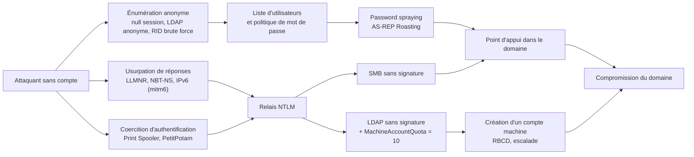

# Rapport de TP : durcissement d'un Active Directory (wyrmwood.local)

## Sommaire

1. [Introduction et résumé](#1-introduction-et-résumé)
2. [Périmètre et objectif](#2-périmètre-et-objectif)
3. [Méthode](#3-méthode)
4. [Le problème de fond : les paramètres par défaut](#4-le-problème-de-fond--les-paramètres-par-défaut)
5. [Chaîne d'attaque](#5-chaîne-dattaque)
6. [Tableau de synthèse des constats](#6-tableau-de-synthèse-des-constats)
7. [Constats détaillés](#7-constats-détaillés)
8. [Pour aller plus loin : déploiement en production](#8-pour-aller-plus-loin--déploiement-en-production)
9. [Précautions avant d'appliquer ces corrections](#9-précautions-avant-dappliquer-ces-corrections)
10. [Limites](#10-limites)
11. [Aide de l'IA générative](#11-aide-de-lia-générative)

---

## 1. Introduction et résumé

Dans ce TP, j'ai audité puis durci le domaine Active Directory `wyrmwood.local`, dans un lab HackTheBox. J'ai relevé **15 constats**. Je les ai tous corrigés et revérifiés sur les deux machines étudiées (DC01 et MS01).

**Ce que je retiens : le principal manque de sécurité d'un Active Directory vient de ses paramètres par défaut.** La plupart des problèmes ne viennent pas d'une faille logicielle ou d'un attaquant très fort. Ils viennent de protocoles anciens activés par défaut (LLMNR, NBT-NS, IPv6, spouleur d'impression), de contrôles non exigés par défaut (signature LDAP et SMB sur les serveurs membres) et de quotas trop permissifs (MachineAccountQuota à 10). Un AD installé et laissé tel quel est donc vulnérable.

**Le scénario le plus inquiétant** enchaîne plusieurs faiblesses sans avoir besoin d'un compte au départ : l'attaquant, présent sur le réseau, usurpe une réponse de résolution de noms, relaie l'authentification NTLM récupérée vers LDAP (non signé), crée un compte machine (grâce au quota par défaut) et monte jusqu'à la compromission du domaine.

---

## 2. Périmètre et objectif

**Objectif.** Trouver les mauvaises configurations de l'AD qu'on peut exploiter sans compte privilégié, évaluer le risque, appliquer les corrections et vérifier qu'elles marchent.

**Environnement.**
- Forêt `wyrmwood.local`, avec les domaines enfants `ops.wyrmwood.local` et `labs.wyrmwood.local`.
- Approbation de forêt externe avec `steelridge.industries`.
- Machines étudiées et durcies : **DC01** (contrôleur de domaine) et **MS01** (serveur membre).
- Connexion par bureau à distance, lab de type HackTheBox.
- Énumération sans authentification avec NetExec : `netexec smb <IP> --users --pass-pol --rid-brute`.

**Hors périmètre.** Postes clients, AD CS, environnement hybride (Entra ID), équipements réseau, et la remédiation des domaines enfants et de l'approbation externe (voir section 10).

**Criticité.** Faible, Moyenne, Élevée ou Critique. C'est mon estimation (facilité d'exploitation sans privilège et impact possible), sans calcul CVSS.

---

## 3. Méthode

Pour chaque constat, je suis les mêmes étapes :

1. **Constat et preuve** : je lis l'état initial et je le montre avec une capture commentée.
2. **Risque, correction et impact** : j'explique le risque, j'applique la correction (d'abord immédiate, puis durable avec une GPO) et je note ce que ça peut casser.
3. **Vérification** : je relis la configuration après correction et je propose un test pour confirmer que l'attaque ne marche plus.

Pour rendre les corrections durables, j'ai créé des GPO dédiées plutôt que de modifier la Default Domain Policy. C'est plus facile à auditer, à cibler par UO et à annuler.

---

## 4. Le problème de fond : les paramètres par défaut

Un Active Directory est pensé pour être compatible et facile à administrer avant d'être sécurisé. Ça se voit dans ses réglages d'origine :

| Réglage | Valeur d'origine | Valeur sécurisée |
|---|---|---|
| MachineAccountQuota | 10 (tout utilisateur crée jusqu'à 10 comptes machine) | 0 |
| Signature LDAP (`LDAPServerIntegrity`) | 1 : négociée, non exigée | 2 : exigée |
| Signature SMB | Non exigée sur les serveurs membres (exigée sur les DC) | Exigée partout |
| LLMNR | Activé | Désactivé |
| NBT-NS (NetBIOS sur TCP/IP) | Activé | Désactivé |
| IPv6 / DHCPv6 / Router Advertisements | Activés et acceptés | Désactivés ou filtrés |
| Spouleur d'impression sur un DC | Activé | Désactivé |
| Politique de mot de passe | Longueur minimale 7, aucun verrouillage de compte | 12 à 14 caractères, verrouillage activé |

Tous les constats ne sont pas des défauts purs. Quatre viennent plutôt d'une configuration locale ou héritée : le paramètre `dSHeuristics` (F-02), la présence d'`Everyone` et `ANONYMOUS LOGON` dans le groupe Pre-Windows 2000 (F-02 et F-03), les comptes sans pré-authentification Kerberos (F-13) et le partage `Transfer` ouvert en écriture (F-15). Pour tout le reste, le problème vient des réglages par défaut.

**Ce que ça implique :** le durcissement devrait faire partie du déploiement dès le départ (une GPO de référence dès la création du domaine), et pas seulement être fait après coup.

---

## 5. Chaîne d'attaque

Le relais NTLM ne se bloque pas avec un seul réglage. Il faut combiner plusieurs contrôles : supprimer l'usurpation, exiger la signature SMB et LDAP, activer le channel binding, mettre le quota de comptes machine à 0 et réduire la coercition.

---

## 6. Tableau de synthèse des constats

| ID | Constat | Criticité | Risque de régression | Captures |
|---|---|---|---|---|
| F-01 | Session nulle SMB sur le DC | Élevée | Moyen | 7, 8, 10, 11 |
| F-02 | Opérations LDAP anonymes autorisées (`dSHeuristics`) | Élevée | Moyen | 12 à 16 |
| F-03 | `Everyone` et `ANONYMOUS LOGON` dans Pre-Windows 2000 Compatible Access | Moyenne | Faible | 20, 21, 22 |
| F-04 | RID brute force possible | Moyenne | Faible | 36, 37, 38 |
| F-05 | LLMNR actif | Élevée | Faible | 59, 60, 61 |
| F-06 | NBT-NS actif | Élevée | Moyen | 62, 63, 64 |
| F-07 | Usurpation DNS via IPv6 (mitm6) | Élevée | Élevé | 41 à 52 |
| F-08 | Signature SMB non exigée | Élevée | Moyen | 53, 54, 55 |
| F-09 | Signature LDAP non exigée | **Critique** | Élevé | 56, 57, 58 |
| F-10 | MachineAccountQuota par défaut (10) | Élevée | Moyen | 1, 2, 3 |
| F-11 | Mots de passe faibles autorisés (GPO) | Élevée | Moyen | 4, 5, 6 |
| F-12 | Politique de mot de passe AD faible | Moyenne | Moyen | 17, 18, 19 |
| F-13 | Comptes sans pré-authentification Kerberos (AS-REP Roasting) | Élevée | Faible | 26, 27, 28 |
| F-14 | Spouleur d'impression actif sur le DC | Élevée | Faible sur un DC | 29, 30, 31 |
| F-15 | Partage `Transfer` modifiable par les utilisateurs non privilégiés | Élevée | Moyen | 32 à 35 |

---

## 7. Constats détaillés

### Thème A : énumération anonyme

#### F-01 : Session nulle SMB sur le contrôleur de domaine
**Criticité :** Élevée

- **Constat :** une session anonyme pouvait se connecter au partage `IPC$` du DC et lister les utilisateurs, les groupes et la politique de mot de passe. `RestrictAnonymous` valait 0.
- **Risque :** l'attaquant récupère sans authentification la liste des comptes et les règles de verrouillage, ce qui lui permet de faire du password spraying en toute sécurité.
- **Correction, étape 1 :** retrait d'`Everyone` du groupe Pre-Windows 2000 Compatible Access (voir aussi F-03).

*Figure 7 : retrait d'Everyone du groupe Pre-Windows 2000 Compatible Access (1/2).*

*Figure 8 : retrait d'Everyone du groupe Pre-Windows 2000 Compatible Access (2/2).*

- **Correction, étape 2 :** restriction de l'accès anonyme. `RestrictAnonymous` passe de 0 à 2 et `RestrictAnonymousSAM` à 1 (clé `HKLM\SYSTEM\CurrentControlSet\Control\Lsa`). La Default Domain Controllers Policy est mise à jour, puis `gpupdate /force` s'exécute sans erreur.

*Figure 10 : application de la GPO des contrôleurs de domaine et restriction de l'accès anonyme dans le registre.*

- **Impact possible :** des outils ou scripts anciens qui utilisent `IPC$` en anonyme ne marcheront plus. Il faut les repérer avant de déployer.
- **Vérification :** `RestrictAnonymous = 2` et `RestrictAnonymousSAM = 1` sont confirmés, et seul `Authenticated Users` reste dans le groupe. Test possible : `netexec smb <IP_DC> -u '' -p '' --users` doit être refusé.

*Figure 11 : vérification des valeurs de registre et du groupe (Authenticated Users uniquement).*

#### F-02 : Opérations LDAP anonymes autorisées (`dSHeuristics`)
**Criticité :** Élevée

- **Constat :** le 7ᵉ caractère de `dSHeuristics` (`fLDAPBlockAnonOps`) valait `2`, ce qui autorise les opérations LDAP anonymes sur toute la forêt.

*Figure 12 : lecture de l'attribut `dSHeuristics`, dont le 7ᵉ caractère vaut 2.*

- **Risque :** on peut énumérer l'annuaire sans aucun identifiant.
- **Correction, étape 1 :** j'ai remis le 7ᵉ caractère à `0` (opérations anonymes bloquées) en gardant les autres caractères de la chaîne.

*Figure 13 : 7ᵉ caractère de `dSHeuristics` remis à 0.*

- **Constat complémentaire :** même avec un `dSHeuristics` correct, le groupe Pre-Windows 2000 Compatible Access contenait `Everyone` (S-1-1-0) et `ANONYMOUS LOGON` (S-1-5-7). Ces deux entrées donnent des droits de lecture aux sessions anonymes.

*Figure 14 : membres du groupe avant correction (Everyone et ANONYMOUS LOGON en plus d'Authenticated Users).*

- **Correction, étape 2 :** `Remove-ADGroupMember` par SID a échoué, car ce sont des *well-known SIDs* stockés comme *foreign security principals*. J'ai donc retiré les entrées directement via l'attribut `member` du groupe.

*Figure 15 : retrait des deux entrées en modifiant l'attribut `member`.*

- **Impact possible :** les applications qui interrogent LDAP sans authentification ne marcheront plus. Il faut les identifier et les tester.
- **Vérification :** il ne reste que `Authenticated Users` (S-1-5-11) et un bind anonyme est maintenant refusé (test : `nxc ldap <IP_DC> -u '' -p ''`). Le scan de contrôle ne remonte plus le constat.

*Figure 16 : vérification finale, seul Authenticated Users reste dans le groupe.*

#### F-03 : Appartenance au groupe Pre-Windows 2000 Compatible Access
**Criticité :** Moyenne

- **Constat :** j'ai listé les membres du groupe avec `Get-ADGroupMember`. Il y avait `Everyone` et `ANONYMOUS LOGON` en plus d'`Authenticated Users`.

*Figure 20 : liste des membres du groupe Pre-Windows 2000 Compatible Access avec `Get-ADGroupMember`.*

- **Risque :** ces deux identités donnent un droit de lecture de l'annuaire à des utilisateurs non authentifiés, donc ils peuvent lister les comptes et groupes du domaine.
- **Correction :** retrait des deux entrées. J'ai aussi vérifié que `EveryoneIncludesAnonymous` vaut `0`, pour que Windows ne remette pas ces identités dans le groupe.

*Figure 21 : retrait d'Everyone et d'ANONYMOUS LOGON du groupe.*

- **Impact possible :** certains outils d'identité anciens et BloodHound en mode anonyme perdent leur accès.
- **Vérification :** seul `Authenticated Users` (S-1-5-11) reste. Test possible : une nouvelle énumération anonyme doit échouer.

*Figure 22 : vérification, seul Authenticated Users (S-1-5-11) reste membre du groupe.*

#### F-04 : RID brute force possible
**Criticité :** Moyenne

- **Constat :** la traduction anonyme SID/nom et l'application des permissions `Everyone` aux anonymes permettaient de retrouver les comptes en parcourant les RID.
- **Risque :** l'attaquant reconstitue la liste des utilisateurs et des groupes sans s'authentifier.
- **Correction, étape 1 :** configuration de la GPO des contrôleurs de domaine.

*Figure 36 : configuration de la GPO des contrôleurs de domaine (Security Options).*

- **Correction, étape 2 :** *Network access: Allow anonymous SID/Name translation* mis sur **Disabled**.

*Figure 37 : désactivation de la traduction anonyme SID/nom.*

- **Correction, étape 3 :** *Network access: Let Everyone permissions apply to anonymous users* mis sur **Disabled**.

*Figure 38 : désactivation de l'application des permissions Everyone aux utilisateurs anonymes.*

- **Impact possible :** certaines requêtes légitimes peuvent être bloquées. Pour le RID brute force, la détection reste un bon complément à la prévention.
- **Vérification :** test `netexec smb <IP_DC> -u '' -p '' --rid-brute`, qui ne doit plus rien retourner.

### Thème B : usurpation de réponses de résolution de noms

#### F-05 : LLMNR actif
**Criticité :** Élevée

- **Constat :** LLMNR n'était pas désactivé sur les machines du domaine.
- **Risque :** un attaquant répond aux requêtes de résolution de noms et capture des hashes NTLM, qu'il peut ensuite craquer ou relayer.
- **Correction immédiate :** j'ai posé `EnableMulticast = 0` dans `HKLM\SOFTWARE\Policies\Microsoft\Windows NT\DNSClient` sur DC01 et MS01.

*Figure 59 : remédiation immédiate, `EnableMulticast = 0` sur les machines.*

- **Correction durable :** GPO dédiée **Disable LLMNR**, liée à la racine du domaine.

*Figure 60 : réglage durable avec la GPO Disable LLMNR.*

- **Impact possible :** la résolution de noms sans DNS fiable est affectée. Il faut un DNS fiable avant de désactiver LLMNR.
- **Vérification :** valeur relue sur DC01 et MS01. **À noter :** désactiver LLMNR seul ne suffit pas, car Windows se rabat sur NBT-NS (voir F-06). Test possible : Responder en mode analyse (`responder -I <interface> -A`) ne doit plus voir de requêtes LLMNR exploitables.

*Figure 61 : vérification finale de la désactivation de LLMNR.*

#### F-06 : NBT-NS (NetBIOS sur TCP/IP) actif
**Criticité :** Élevée

- **Constat :** NetBIOS sur TCP/IP était actif sur les cartes réseau.

*Figure 62 : audit initial, NetBIOS sur TCP/IP actif sur les cartes réseau.*

- **Risque :** même scénario que LLMNR : usurpation de réponse, capture de hashes, relais.
- **Correction immédiate :** `TcpipNetbiosOptions = 2` sur toutes les cartes de DC01 et MS01.

*Figure 63 : remédiation immédiate, NetBIOS désactivé sur toutes les cartes.*

- **Correction durable :** réglage rendu persistant.

*Figure 64 : remédiation durable de la désactivation de NetBIOS.*

- **Impact possible :** la résolution de noms ancienne (imprimantes, scanners, serveurs avec plusieurs cartes) est à vérifier.
- **Vérification :** relecture de `TcpipNetbiosOptions` sur chaque carte, y compris celle du VPN du lab. Une seule carte oubliée suffit à faire échouer le contrôle.

#### F-07 : Usurpation DNS via IPv6 (mitm6)
**Criticité :** Élevée

- **Constat :** IPv6 était actif et préféré à IPv4, alors qu'il n'y a aucun serveur DHCPv6 légitime. Un attaquant peut se faire passer pour le serveur DNS IPv6 et détourner les requêtes. J'ai fait l'audit en cinq étapes.

*Figure 41 : vérification d'IPv6 sur les cartes réseau.*

*Figure 42 : identification des adresses IPv6 attribuées.*

*Figure 43 : identification des serveurs DNS IPv6 configurés.*

*Figure 44 : vue d'ensemble de la configuration IPv6.*

*Figure 45 : test pour savoir si le DNS peut être injecté via IPv6.*

- **Risque :** capture de hashes ou relais NTLM (SMB, LDAP) à partir de l'usurpation du DNS IPv6.
- **Correction, étape 1 :** Router Discovery désactivé sur les interfaces Ethernet0 2 et Ethernet1 (`Set-NetIPInterface -RouterDiscovery Disabled`).

*Figure 46 : désactivation de Router Discovery sur les deux interfaces.*

*Figure 47 : vérification des modifications avec `Get-NetIPInterface`.*

- **Correction, étape 2 :** `DisabledComponents = 255`. Cette valeur n'est appliquée qu'après un redémarrage, que je ne pouvais pas faire sur HackTheBox.

*Figure 48 : IPv6 désactivé via la valeur de registre `DisabledComponents = 255`.*

*Figure 49 : vérification de la valeur dans le registre.*

- **Correction, étape 3 :** désactivation de la liaison `ms_tcpip6` sur les cartes, qui s'applique tout de suite, sans redémarrage.

*Figure 50 : désactivation de la liaison IPv6 sur les cartes, puis vérification.*

- **Correction, étape 4 :** extension à tout le domaine avec la GPO **Disable IPv6**, liée à la racine. Comme la GPO n'était pas encore appliquée sur MS01, j'ai aussi posé la valeur directement sur cette machine.

*Figure 51 : application de la valeur à toutes les machines avec la GPO Disable IPv6.*

- **Correction, étape 5 :** règles de pare-feu pour bloquer DHCPv6 (entrée et sortie) et les Router Advertisements, ce qui empêche l'attaquant de se faire passer pour le serveur DNS IPv6.

*Figure 52 : blocage de DHCPv6 et des Router Advertisements par le pare-feu.*

- **Impact possible :** **Microsoft déconseille de désactiver IPv6** sans tests poussés, car cela peut gêner le DNS intégré à AD, Kerberos et le clustering.
- **Vérification :** valeur confirmée à 255 sur DC01 et MS01, et le contrôle du tableau de bord est passé en remédié. Test possible : `mitm6 -d wyrmwood.local` en lab ne doit plus obtenir de réponse DHCPv6 ni détourner le DNS.
- **Recommandation pour la production :** plutôt qu'une désactivation complète, utiliser `DisabledComponents = 0x20` (préférer IPv4) avec le blocage de DHCPv6 et des Router Advertisements.

### Thème C : relais NTLM

#### F-08 : Signature SMB non exigée
**Criticité :** Élevée

- **Constat :** DC01 exige déjà la signature (comportement par défaut d'un DC).

*Figure 53 : audit initial sur DC01, `RequireSecuritySignature` et `EnableSecuritySignature` à True.*

- **Constat, suite :** **MS01 ne l'exigeait pas** (`False` pour les deux valeurs), c'est lui le point faible.

*Figure 54 : MS01 vulnérable, signature SMB non exigée.*

- **Risque :** relais d'une authentification obtenue par usurpation ou coercion vers une machine SMB, avec possibilité d'exécuter du code.
- **Correction :** signature exigée côté serveur et côté client, appliquée directement sur MS01 puis rendue durable avec la GPO **Require SMB Signing**. Le tableau de bord indiquait « At least one setting is 0 » : j'ai dû poser les 4 valeurs de registre à 1 (`RequireSecuritySignature` et `EnableSecuritySignature` sous `LanmanServer` et `LanmanWorkstation`).

*Figure 55 : création de la GPO Require SMB Signing pour le réglage durable.*

- **Impact possible :** les anciens clients ou appareils non conformes ne pourront plus se connecter. Il faut tester la compatibilité et les performances.
- **Vérification :** les 4 valeurs sont à `1` sur DC01 et MS01, et le contrôle est passé en remédié. Test possible : `nmap -p445 --script smb2-security-mode <IP>` doit afficher « signing enabled and required ».

#### F-09 : Signature LDAP non exigée
**Criticité :** **Critique**

- **Constat :** `LDAPServerIntegrity` valait `1` (signature seulement négociée), ce qui reste vulnérable.

*Figure 56 : audit initial, `LDAPServerIntegrity = 1` sur DC01.*

- **Risque :** relais NTLM vers LDAP, qui permet d'énumérer le domaine, de créer un compte machine contrôlé et d'escalader les privilèges.
- **Correction immédiate :** `LDAPServerIntegrity = 2` dans le registre de DC01.

*Figure 57 : remédiation immédiate, `LDAPServerIntegrity` passé à 2.*

- **Correction durable :** GPO **Require LDAP Signing** liée à l'UO Domain Controllers.

*Figure 58 : réglage durable avec la GPO Require LDAP Signing.*

- **Impact possible :** les applications qui font un simple bind LDAP en clair (port 389) ne marcheront plus. LDAPS (636) n'est pas concerné. En production, il faut **passer d'abord en mode audit** (événement 2889) avant d'exiger la signature.
- **Vérification :** valeur relue à `2`, GPO appliquée au DC (`gpresult /r /scope:computer`) et aucune autre GPO ne l'écrase. Test possible : `nxc ldap <IP_DC> -u <user> -p <pass> -M ldap-checker`.
- **Complément recommandé :** `LdapEnforceChannelBinding = 2` pour couvrir aussi LDAPS.

#### F-10 : MachineAccountQuota par défaut
**Criticité :** Élevée

- **Constat :** après connexion au DC en bureau à distance, j'ai lu `ms-DS-Machine-Account-Quota`. Il vaut 10 : n'importe quel utilisateur du domaine peut créer jusqu'à 10 comptes machine.

*Figure 1 : connexion au contrôleur de domaine par bureau à distance.*

*Figure 2 : lecture de la valeur actuelle de `ms-DS-Machine-Account-Quota`.*

- **Risque :** combiné à un relais vers LDAP, l'attaquant crée un compte qu'il contrôle et s'authentifie sans casser de hash (RBCD et variantes).
- **Correction :** valeur passée à 0 (`Set-ADDomain ... -Replace @{"ms-DS-Machine-Account-Quota"="0"}`).

*Figure 3 : passage de `ms-DS-Machine-Account-Quota` à 0 et vérification.*

- **Impact possible :** les utilisateurs standard ne peuvent plus joindre de machines au domaine. Il faut déléguer le droit « Créer des objets Ordinateur » à un groupe dédié (par exemple « Opérateurs de jonction de domaine ») sur l'UO concernée.
- **Vérification :** relecture de l'attribut avec `Get-ADObject ... -Properties ms-DS-Machine-Account-Quota`. La modification se réplique aux autres DC selon le calendrier habituel, donc un autre DC peut afficher un moment l'ancienne valeur.

### Thème D : identités et authentification

#### F-11 : Mots de passe faibles autorisés
**Criticité :** Élevée

- **Constat :** la politique n'empêchait pas le password spraying (mots de passe courts ou simples, pas de verrouillage).
- **Risque :** un compte peut être compromis avec un mot de passe courant testé sur tous les utilisateurs.
- **Correction, étape 1 : stratégie de mot de passe (GPO).** Longueur minimale 12 à 14, complexité activée, ancienneté maximale 60 à 90 jours, historique de 24, ancienneté minimale 1 jour.

*Figure 4 : GPO, stratégie de mot de passe renforcée.*

- **Correction, étape 2 : stratégie de verrouillage de compte.** Seuil de 5 à 10 tentatives, durée de 15 min, réinitialisation du compteur à 15 min.

*Figure 5 : GPO, stratégie de verrouillage de compte.*

- **Correction, étape 3 : application** avec `gpupdate /force`.

*Figure 6 : application des stratégies avec `gpupdate /force`.*

- **Impact possible :** changements de mot de passe forcés et échecs possibles sur les comptes de service ou partagés. Il faut les recenser avant.
- **Vérification :** relecture de la politique effective après `gpupdate`. Test possible : un password spraying en lab doit déclencher le verrouillage.

#### F-12 : Politique de mot de passe AD faible
**Criticité :** Moyenne

- **Constat :** aucune politique fine (PSO) n'était définie, donc la politique par défaut du domaine s'applique à tout le monde, comptes privilégiés compris. La commande de recherche de PSO n'a rien renvoyé, ce qui est normal ici.

*Figure 17 : lecture de la politique de mot de passe actuelle (aucune PSO définie).*

- **Risque :** ça facilite le brute force et le password spraying.
- **Correction :** politique du domaine renforcée, avec `MaxPasswordAge` à 90 jours pour rester cohérent avec la GPO du constat F-11.

*Figure 18 : modification de la politique du domaine (`MaxPasswordAge` à 90 jours).*

- **Impact possible :** voir F-11.
- **Vérification :** relecture de la politique effective. **Recommandation :** créer une politique fine plus stricte pour les comptes privilégiés. À noter que le NIST (SP 800-63B) conseille de privilégier la longueur et le filtrage des mots de passe compromis plutôt que le changement forcé régulier : c'est un choix à arbitrer.

*Figure 19 : vérification de la politique de mot de passe après modification.*

#### F-13 : Comptes sans pré-authentification Kerberos (AS-REP Roasting)
**Criticité :** Élevée

- **Constat :** deux comptes, `svc-scan` et `iisadmin`, n'exigeaient pas la pré-authentification Kerberos.

*Figure 26 : liste des comptes sans pré-authentification Kerberos (`svc-scan` et `iisadmin`).*

- **Risque :** un attaquant peut récupérer un TGT chiffré et le casser hors ligne, sans avoir de compte.
- **Correction :** `Set-ADAccountControl -DoesNotRequirePreAuth $false` sur les deux comptes.

*Figure 27 : réactivation de la pré-authentification Kerberos sur les comptes concernés.*

- **Impact possible :** des systèmes anciens ou hors domaine peuvent ne plus s'authentifier. Il faut valider les comptes de service.
- **Vérification :** `DoesNotRequirePreAuth` est à `False` sur les deux comptes. Test possible : `GetNPUsers.py` (Impacket) ne doit plus retourner de hash. **Recommandation :** réinitialiser le mot de passe de ces deux comptes par prudence.

*Figure 28 : revérification, `DoesNotRequirePreAuth` défini sur False.*

### Thème E : services et partages

#### F-14 : Spouleur d'impression actif sur le contrôleur de domaine
**Criticité :** Élevée

- **Constat :** le service Print Spooler tournait sur le DC, alors qu'AD n'en a pas besoin dans cet environnement.

*Figure 29 : vérification de l'état du service Print Spooler (en cours d'exécution).*

- **Risque :** coercition d'authentification (PrinterBug) : l'attaquant force le DC à s'authentifier vers lui, puis relaie l'authentification NTLM.
- **Correction :** `Stop-Service Spooler` puis `Set-Service Spooler -StartupType Disabled`.

*Figure 30 : arrêt et désactivation du service au démarrage.*

- **Impact possible :** l'impression à distance et les imprimantes déployées par GPO ne marcheront plus. Sans risque sur un DC ou un serveur qui ne sert pas à imprimer.
- **Vérification :** service arrêté et désactivé. Test possible : `nxc smb <IP_DC> -M spooler` ne doit plus détecter le service.

*Figure 31 : vérification du service après désactivation (arrêté, démarrage désactivé).*

#### F-15 : Partage `Transfer` modifiable par les utilisateurs non privilégiés
**Criticité :** Élevée

- **Constat :** j'ai d'abord listé les partages réseau, puis vérifié les droits exacts de chacun. Le partage `Transfer` donnait le contrôle total (`Full`) au groupe `Domain Users`.

*Figure 32 : identification des partages réseau du serveur.*

*Figure 33 : vérification des droits exacts, `Domain Users` en `Full` sur `Transfer`.*

- **Risque :** dépôt de fichiers piégés pour voler des identifiants, modification ou suppression de données, exfiltration.
- **Correction :** j'ai remplacé `Full` par `Read` (`Revoke-SmbShareAccess` puis `Grant-SmbShareAccess`), selon le principe du moindre privilège.

*Figure 34 : correction du partage `Transfer`, droits Full remplacés par Read.*

- **Impact possible :** les dossiers partagés, scripts de connexion et lecteurs réseau qui écrivent dans ce partage sont à recenser.
- **Vérification :** `Get-SmbShareAccess -Name Transfer` confirme le droit `Read` seul. **Recommandation :** vérifier aussi les ACL NTFS et faire un audit des partages chaque trimestre (PowerHuntShares).

*Figure 35 : vérification des permissions SMB après correction (plus de droit d'écriture).*

---

## 8. Pour aller plus loin : déploiement en production

Dans une vraie entreprise, je déploierais ces corrections en trois vagues.

**Vague 1 : gains rapides, peu de risque de casse (0 à 30 jours)**
- F-14 : désactiver le spouleur sur tous les DC et serveurs qui n'impriment pas.
- F-13 : corriger les comptes sans pré-authentification et changer leurs mots de passe.
- F-15 : revoir les droits des partages ouverts et auditer tous les partages.
- F-03 et F-04 : retirer `Everyone` et `ANONYMOUS LOGON` de Pre-Windows 2000 et durcir la traduction SID/nom.
- F-05 : désactiver LLMNR avec une GPO dédiée (après avoir vérifié le DNS).

**Vague 2 : changements qui demandent un audit avant (30 à 60 jours)**
- F-09 : audit des binds LDAP non signés (événement 2889), correction des applications, puis signature exigée et channel binding.
- F-08 : signature SMB partout, après inventaire des clients anciens.
- F-06 : désactiver NBT-NS, après inventaire des équipements anciens.
- F-01 et F-02 : restreindre l'accès anonyme SMB et LDAP, après inventaire des usages.
- F-10 : MachineAccountQuota à 0, après avoir créé le groupe délégué pour joindre les machines.

**Vague 3 : chantiers plus lourds (60 à 90 jours)**
- F-07 : tests poussés sur IPv6, puis `DisabledComponents = 0x20` et filtrage de DHCPv6 et des Router Advertisements.
- F-11 et F-12 : politique de mot de passe renforcée, politiques fines pour les comptes privilégiés, filtre de mots de passe compromis, MFA.

**En continu**
- Audit NTLM (`AuditNTLMInDomain`), puis restriction progressive de NTLM.
- GPO de durcissement de référence dès la création d'un nouveau domaine ou serveur.
- Audits réguliers de l'AD (par exemple PingCastle ou Purple Knight) et des partages.
- Supervision et alertes sur les authentifications anormales et le RID brute force.
- Chaque correction testée avant déploiement.

---

## 9. Précautions avant d'appliquer ces corrections

Les recommandations d'un audit ne doivent pas être appliquées sans réfléchir : chacune peut casser un usage. Voici les principaux points d'attention :

- **Signature LDAP et SMB** : applications en simple bind LDAP, anciens clients et équipements non conformes. Commencer par le mode audit.
- **NBT-NS et LLMNR** : résolution de noms ancienne, imprimantes, scanners, serveurs avec plusieurs cartes. Avoir un DNS fiable.
- **IPv6** : DNS intégré à AD, Kerberos, clustering. Éviter la désactivation complète en production.
- **MachineAccountQuota à 0** : adapter le processus de jonction au domaine avec une délégation.
- **Accès anonyme** : repérer les outils d'administration et d'identité anciens.
- **Spouleur** : sûr seulement sur les DC et serveurs qui n'impriment pas.
- **Politique de mot de passe** : attention aux comptes de service et comptes partagés.

---

## 10. Limites

- Les corrections ont été appliquées et vérifiées sur **DC01 et MS01** du domaine `wyrmwood.local`. Les domaines enfants (`ops`, `labs`) et l'approbation de forêt externe (`steelridge.industries`) n'ont pas été traités dans ce rapport.
- Le périmètre n'inclut pas AD CS, les postes clients ni l'environnement hybride.
- Les niveaux de criticité sont des estimations qualitatives.
- Sur HackTheBox je n'ai pas pu redémarrer les machines, donc l'effet complet de `DisabledComponents` (F-07) n'a pas été testé après redémarrage.

---

## 11. Aide de l'IA

Pour ce rapport, j'ai utilisé une IA générattive pour **réorganiser le contenu et corriger les fautes** d'orthographe et de formulation. Le lab, les manipulations ont été aider pour reformulation de commandes quelques fois par IA, les captures d'écran et les constats viennent de mon travail pratique. Le rendu n'est pas parfait et peut encore contenir des maladresses.
